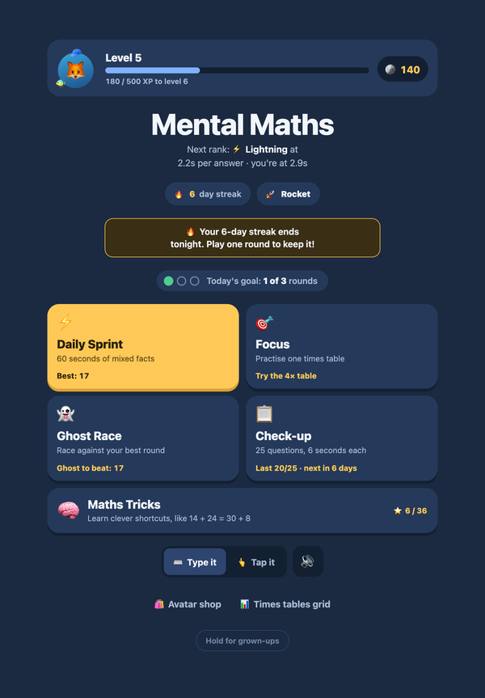
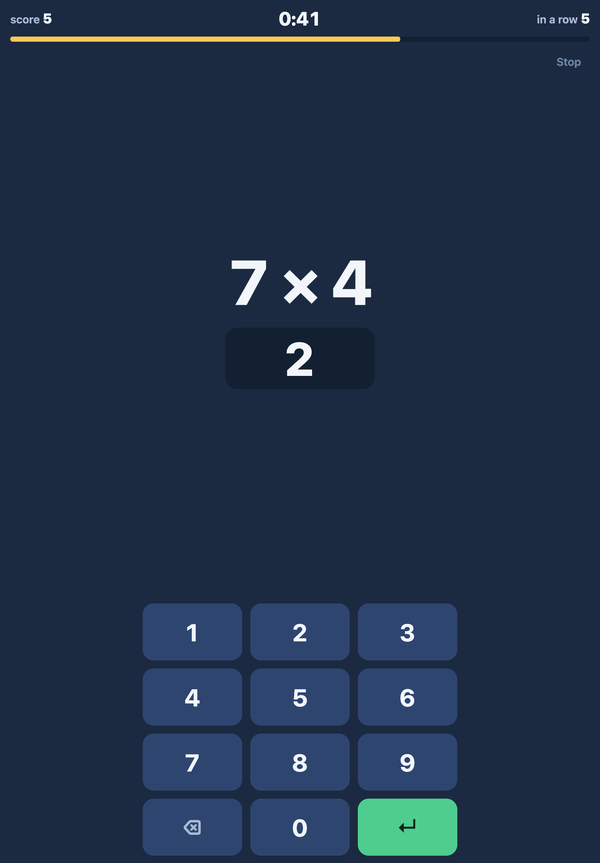
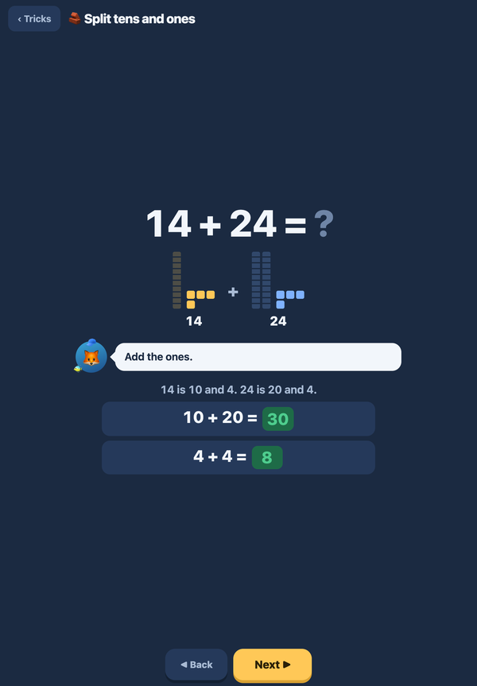
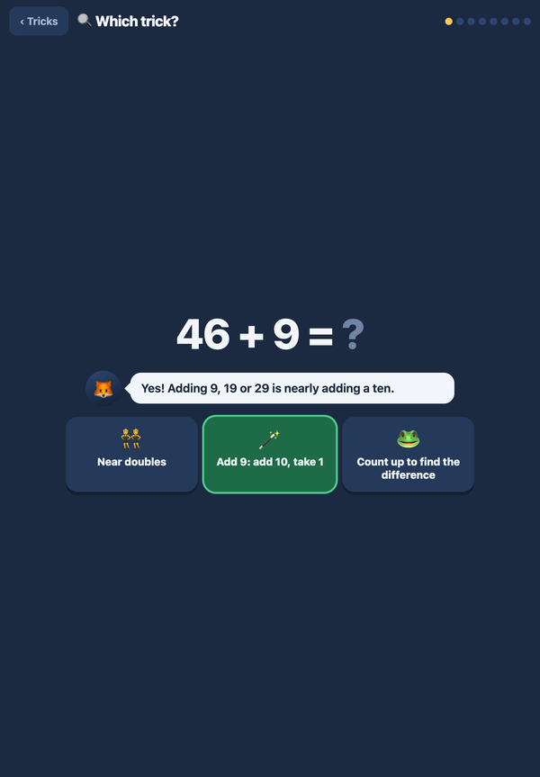
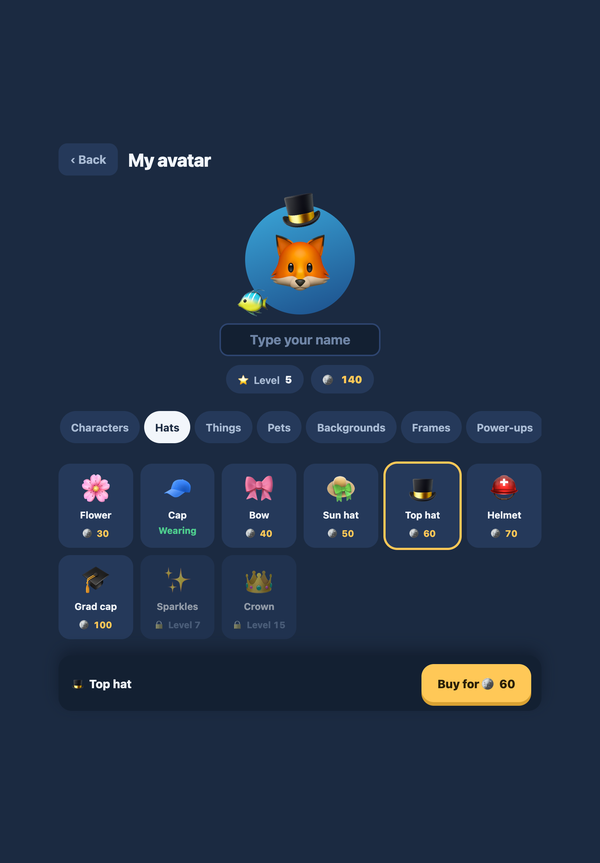
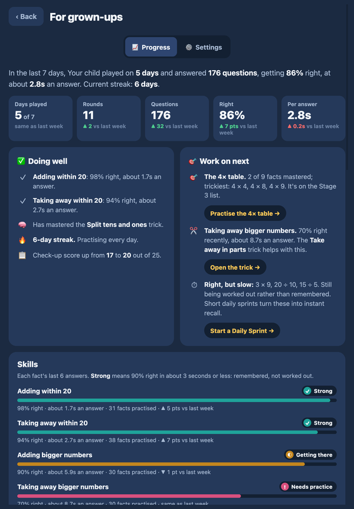

# Mental Maths

A mental maths practice app for 8-year-olds, built for an iPad. It works offline once installed from the Home Screen, has no accounts and no ads, and keeps all progress on the device.

**Play it:** https://3r3bx.github.io/mental-maths/

<p>
  
  
  
  
  
  
</p>

The content follows the **Cambridge Primary Stage 3** maths curriculum: addition and subtraction facts to 20 with speed, adding and subtracting within 100, the 2, 3, 4, 5 and 10 times tables by heart, and division as the inverse of multiplication. The 3× and 4× tables get extra weight, because they're the usual gap for children coming from the IB PYP.

## What's in it

### Games

| Mode | What it does |
|---|---|
| ⚡ **Daily Sprint** | 60 seconds of mixed facts, at the child's current difficulty. |
| 🎯 **Focus** | One times table. Starts with a look-first card that marks the child's tricky facts. |
| 👻 **Ghost Race** | Race against your own best round, shown as two lanes. Same questions as Daily Sprint. |
| 📋 **Check-up** | 25 times-table questions, 6 seconds each, due weekly. Tracks progress week to week. |

Every round opens with three untimed warm-up questions. Answers can be typed on a number pad or tapped from a 12-button grid. Only typed answers count towards mastery, because tapping can be done by elimination.

### Difficulty that adjusts itself

Adding, taking away, times tables and dividing each have their own difficulty, from 1 to 5:

| | 1 | 2 | 3 | 4 | 5 |
|---|---|---|---|---|---|
| Adding | facts to 20 | 2-digit + 1-digit | 2-digit + 2-digit, within 100 | 3-digit + 2-digit | 3-digit + 3-digit |
| Taking away | facts to 20 | 2-digit − 1-digit | 2-digit − 2-digit, within 100 | 3-digit − 2-digit | 3-digit − 3-digit |
| Times tables | 2×, 5×, 10× | 3× and 4× | all Stage 3 tables | 6× and 8× | 7×, 9×, 11×, 12× |
| Dividing | ÷ 2, 5, 10 | ÷ 3 and 4 | all Stage 3 tables | ÷ 6 and 8 | ÷ 7, 9, 11, 12 |

- Daily Sprint and Ghost Race ask about 60% of questions at the current difficulty. The rest are easier review.
- Typed answers at the current difficulty fill a window of the last 12. Once 10 or more of them are at least 85% right, the difficulty goes up, and the child sees "⬆️ Harder adding unlocked!".
- If the last 8 fall below 60%, it goes down quietly, with no message, so a struggling child never sees a "demotion".
- Everything starts at 2. Nothing goes above 3 (the end of Stage 3) unless a grown-up allows it.

A missed fact comes back two or three questions later in the same round. After the round, the results screen shows how to work it out: a dot picture for times tables, a "through ten" step for sums, and a link to the matching Maths Trick.

### Maths Tricks

Fourteen mental strategies, taught step by step and without a timer:

- **Adding and taking away:**
  - Ten friends (6 + 9 + 4)
  - Bridge through 10 (8 + 5)
  - Near doubles (6 + 7)
  - Split tens and ones (14 + 24 = 30 + 8)
  - Add 9: add 10, take 1 (46 + 9)
  - Take away in parts (57 − 23)
  - Count up to find the difference (42 − 38)
  - Bonds to 100 (64 + ? = 100: hop to 70, then to 100)
- **Times and sharing:**
  - Times 10: digits jump (23 × 10)
  - Times 5 is half of times 10
  - Times 4 is double double
  - Divide by thinking times (24 ÷ 4)
  - Times 9: times 10, take one (extension)
  - Double bigger numbers (double 36 = 60 + 12)

Each lesson has three stages:

1. Watch a worked example.
2. Fill in the steps of 3 problems with support. This earns the first star.
3. Use the trick on 6 problems unaided. This earns up to 3 stars.

Each strategy comes with the picture teachers use for it: a number line, ten frames, tens rods and ones cubes, a dot array, or a place-value chart.

**🔍 Which trick?** unlocks once 3 tricks are learned. It's 8 problems from the tricks the child knows. For each one they:

1. Pick the best strategy out of three.
2. See why it fits.
3. Solve the problem.

The wrong options are always tricks that genuinely don't fit the problem, so there's only one right answer. Choosing a strategy is the skill that comes after learning them.

### Rewards

- **XP and levels:** XP is never spent. A typed answer earns twice the XP of a tapped one.
- **Coins:** spent in an **avatar shop** of about 60 items, some unlocked by level.
- **Daily goal:** 3 rounds a day.
- **Streaks:** with **streak freezes** that cover a missed day, and coin rewards at streak milestones.
- **Speed rank:** based on median answer time. A rank, once earned, is never taken away.
- **Times-tables grid:** fills green as facts are mastered.

### For grown-ups

Press and hold **Hold for grown-ups** on the home screen for 2 seconds.

- **Progress:**
  - the last 7 days compared with the week before;
  - what's going well, and up to three next steps, each with a button that starts the right activity;
  - skills by area, rated *Strong*, *Getting there* or *Needs practice*;
  - each Stage 3 times table, with its tricky facts named;
  - facts that keep going wrong, and facts that are right but slow;
  - a 14-day practice chart and a check-up chart.
- **Settings:**
  - **Practice lock:** keep Daily Sprint and Ghost Race on one times table or one topic, for example before a school test. While it's on, a lock shows on the child's home screen and a banner shows on the report, so it isn't forgotten. Locked rounds don't change the difficulty.
  - **Difficulty:** see each difficulty and nudge it with − and +. "Allow harder than Stage 3" opens difficulties 4 and 5.
  - Daily streak reminders, and backup and restore.

Ratings use each fact's last 6 answers, so they describe how things are going now. "Strong" means 90% right in about 3 seconds or less: the fact is remembered, not worked out.

## Install on an iPad

1. Open **https://3r3bx.github.io/mental-maths/** in **Safari**. Other browsers on the iPad can't add it as an app.
2. Tap **Share → Add to Home Screen → Add**.
3. Open it from the new icon once while online.

After that it works offline. Always open it from the icon. Progress saved by the Home Screen app is protected, whereas progress in a normal Safari tab can be cleared after 7 days without a visit.

> Opening `index.html` from the Files app won't work. Files shows HTML as a preview with scripts switched off. The app has to be loaded from a web address once.

## Privacy

- No accounts, no analytics, no ads, no third-party scripts.
- Progress is stored only in the iPad's local storage. The **Settings → Back up progress** button saves a copy to Files.
- The daily reminder push carries no data. The iPad writes the message itself from its own saved streak.

## How it works

The whole app is one `index.html` file, written in plain HTML, CSS and JavaScript. There's no build step, no framework and no dependencies, so it still runs exactly as written years from now.

```
index.html                  the app: styles, screens and all logic
sw.js                       service worker: offline cache, and the reminder notification
manifest.webmanifest        Home Screen name, icon and colours
icon-180.png, icon-512.png  app icons
docs/screenshots/           images for this README
.github/workflows/streak-reminder.yml   sends the daily reminder
.github/push/send.mjs       Web Push sender (no dependencies)
```

The script inside `index.html` is split into labelled sections:

| Section | Contents |
|---|---|
| `storage` | Progress saved in `localStorage` under one key, with a version number so old saves are upgraded, not lost. |
| `questions` | Question generator, aligned to Stage 3. Each question remembers its difficulty tier. |
| `adapt` | The self-adjusting difficulty and the grown-up practice lock. |
| `hints`, `tricks` | Worked steps and pictures, plus `trickFits`, which decides which tricks suit a problem in Which trick?. |
| `options` | The tap grid. |
| `mastery` | Per-fact records (last 6 results, speed, streak of quick right answers) and fact families: 3 × 4, 4 × 3, 12 ÷ 3 and 12 ÷ 4 count as one. |
| `economy`, `shop` | XP, levels, coins, streak freezes, milestones and the avatar catalogue. |
| `report` | What the grown-ups progress page says. |
| `ui`, `game loop` | The screens and the round itself. |

**Offline.** The service worker serves the saved copy straight away and fetches a fresh one in the background. An update therefore appears on the second launch after it's published.

## Daily streak reminders

A scheduled GitHub Action sends one Web Push a day to each saved iPad:

- If today's round isn't done, the iPad shows "🔥 Your streak ends tonight!"
- If it is done, the iPad shows "✅ Streak safe!" (Safari requires every push to display something).

It needs two repository secrets, under **Settings → Secrets and variables → Actions**:

| Secret | What it is |
|---|---|
| `VAPID_PRIVATE_KEY` | The private half of the sender key. Its public half is `VAPID_PUBLIC` in `index.html` and `.github/push/send.mjs`. If you replace the key pair, update both, then switch reminders on again on each iPad. |
| `PUSH_SUBSCRIPTIONS` | The reminder code from each iPad: **Hold for grown-ups → Settings → Turn on reminders → Copy code**. For several iPads, put one code per line. |

To set it up:

1. Open the app from its Home Screen icon. This needs iPadOS 16.4 or later.
2. Turn on reminders and copy the code.
3. Save the code as the `PUSH_SUBSCRIPTIONS` secret.
4. Test it from **Actions → Streak reminder → Run workflow**.

The schedule is `0 13 * * *`: 13:00 UTC, which is 5:00 pm at UTC+4. Change the `cron` line in `.github/workflows/streak-reminder.yml` to suit your timezone. GitHub can start scheduled jobs a few minutes late. The workflow re-enables itself on each run, so GitHub's 60-day pause for inactive repositories doesn't switch it off.

The Actions logs of a public repository are public. The sender therefore logs only the push service's host name, never an iPad's address.

## Working on it

Serve the folder locally. Service workers need `localhost` or https:

```sh
python3 -m http.server 8000
# then open http://localhost:8000
```

On a computer, the keyboard works in every game: digits, Backspace and Enter.

To publish a change, commit and push to `main`. GitHub Pages redeploys in about a minute.

## Not built yet

- Fractions, money and time questions, such as half of 18, change from $5, and reading a clock.
- Word problems.
- Bringing missed facts back on later days (spaced repetition across sessions). Today they come back within the same round.
- More than one child on the same iPad.
